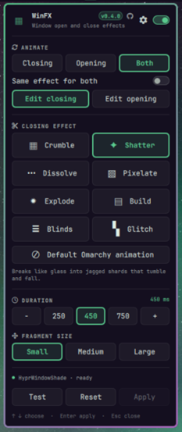
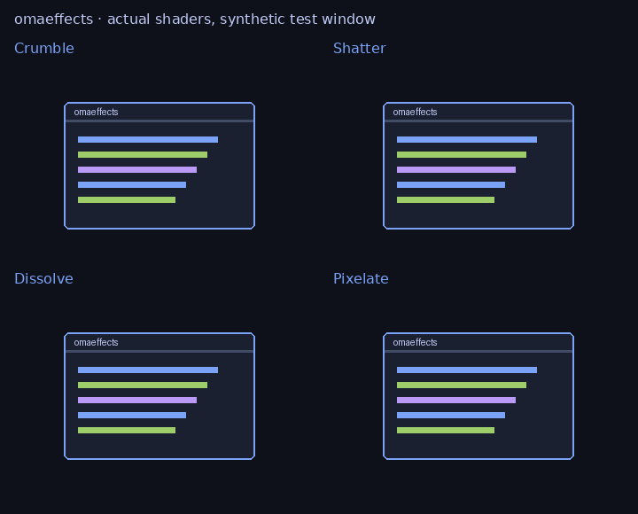

# WinFX

Window open and close effects for [Omarchy](https://omarchy.org/) / Hyprland. Eight effects, picked from a panel that follows your theme.

<p>
  
</p>



*Closing, rendered from the shipped shaders on a synthetic window. Opening plays each effect in reverse.*

- **Eight effects.** Crumble, Shatter (jagged glass shards), Dissolve, Pixelate,
  Explode, Build, Blinds and Glitch.
- **Opening and closing.** Animate closing, opening or both. Opening plays an
  effect in reverse, so Build assembles a window from the bottom up and Explode
  pulls its chunks together.
- **Separate or synced.** With both, **Same effect for both** is on by default.
  Turn it off to give opening and closing their own effect, duration and
  fragment size.
- **Keep Omarchy's animation on one side.** Choose Default for opening or closing
  and WinFX shades only the other.
- **Make it yours.** The gear in the panel header opens its settings: a
  **Compact**, **Normal** or **Roomy** layout, a **Small**, **Normal** or
  **Large** font size, an accent colour (the theme's own, or any colour from its
  palette) and a switch for the version and GitHub link. They are stored in
  `shell.json` and also appear under `omarchy bar set videinfra.omarchy-winfx`.

Targets **Omarchy 4.0.5 / Hyprland 0.56.2**. The effects run on the
[HyprWindowShade](https://github.com/ManofJELLO/HyprWindowShade) plugin, which is
third-party experimental compositor code built against your running Hyprland by
hyprpm.

## Install

```bash
omarchy plugin add https://github.com/thevideinfra/omarchy-winfx.git --enable --yes
```

The widget appears in the bar. Open it and click **Install**. A terminal opens and
runs `install.sh`: it writes one marked Lua loader into `hyprland.lua`, builds the
backend if it is missing, restarts the shell and leaves effects **disabled**.

The backend step checks for `base-devel`, `hyprpm`, `cmake`, `cpio`, `git` and
`pkgconf`, and installs missing packages through pacman. It asks for administrator
authorization through `sudo` in the terminal, and declined or failed package
installation stops setup. It then installs, builds and enables HyprWindowShade.
hyprpm may ask permission to prepare matching headers. Review its output: the
installer never forces a plugin load or upgrades Hyprland. The same steps run from a
shell with `~/.config/omarchy/plugins/videinfra.omarchy-winfx/install.sh --backend`
(without `--backend` if the backend is already loaded).

## Use

Pick an effect, switch **ON** in the header and click **Apply**. **Test** opens a
window in your default terminal; press any key in it to close it and watch the
effect. The test uses the applied settings, so apply pending changes first.

- **Animate:** Closing, Opening or Both.
- **Effect:** one of the eight, or Default for Omarchy's own animation.
- **Duration:** 150–1500 ms, with 250/450/750 presets and ±50 ms steps.
- **Fragment size:** Small, Medium or Large. It scales the pieces, bricks, strips or
  glitch bands of every effect.
- **Reset:** stages the defaults (disabled, Crumble, 450 ms, medium). Apply commits it.
- **Keyboard:** arrows select an effect, Return applies, Escape closes.

The panel follows the shell's current theme colours, font, border and scaling.
There is no background polling process, and the Test window is the only window
WinFX ever opens or closes.

## Behaviour and limitations

Close requests are untouched. The backend animates the compositor's closing
snapshot after the application actually closes, including the close button,
keyboard shortcut and application exit. Unsaved-document prompts remain normal.
No screenshots are stored. Movement and workspace animations are untouched.

- **Fallback shaders.** WinFX sets fallback open and close shaders; explicit
  per-application shader rules take priority. It doesn't animate layer surfaces
  (bar, launcher, popups).
- **Opening runs on top of Hyprland's own open animation,** so a strong `windowsIn`
  fade or popin can mask part of it. Hyprland animations must be enabled, or no
  close snapshot exists.
- **`foot` can't animate on close.** It gives Hyprland no window content when it
  closes, so its close shows only a fading border. Opening works, and other terminals
  such as Alacritty close normally.
- **Pieces stay inside the window's box.** Explode's outer chunks and Blinds' strips
  are clipped at its edges, and fragment travel is limited. Shatter cuts the window
  into jagged Voronoi shards; it is not a physics simulation.
- **Needs more testing:** fullscreen windows, rotated or scaled monitors, NVIDIA and
  several windows closing at once. See `docs/VALIDATION.md`.

This release intentionally rejects other Hyprland versions. After an upgrade,
leave effects disabled until compatibility has been checked. `hyprpm update`
rebuilds shared plugins; a compositor restart may also be required after package
updates. The installed version number alone is not proof of matching binary ABI;
never bypass hyprpm's checks or force-load a `.so`.

## Files and recovery

- Plugin: `~/.config/omarchy/plugins/videinfra.omarchy-winfx/`
- Settings: `~/.config/omarchy-winfx/settings.json`
- Generated shaders and rules: `~/.config/omarchy-winfx/shaders/close.glsl`,
  `open.glsl` and `active.lua`
- Backups: `~/.config/omarchy-winfx/backups/`
- Integration: one line ending `-- omarchy-winfx managed loader` in
  `~/.config/hypr/hyprland.lua`, and one widget in `~/.config/omarchy/shell.json`.

Writes are serialized and replaced atomically per file; failed reloads restore
prior files. Backups are kept before integration files are edited. Symlinked
configuration files keep their links. Multi-file updates are not power-loss
atomic. No keybindings are changed.

If startup is affected, remove the single line ending
`-- omarchy-winfx managed loader` from `~/.config/hypr/hyprland.lua` from a TTY.
This prevents the rule and its startup `hyprpm reload` callback from running.
If you have another hyprpm startup hook, also run `hyprpm disable HyprWindowShade`
before restarting the session. Do not delete unrelated configuration.

## Uninstall

Run before deleting the plugin directory:

```bash
~/.config/omarchy/plugins/videinfra.omarchy-winfx/uninstall.sh
```

It removes the loader, the bar entry and the installed plugin files, reloads
Hyprland and restarts the shell. It keeps your settings, the backups and the shared
HyprWindowShade backend. `omarchy plugin remove` alone cannot remove the Lua loader,
so use the script.

## CLI

```bash
~/.config/omarchy/plugins/videinfra.omarchy-winfx/bin/omarchy-winfx status
~/.config/omarchy/plugins/videinfra.omarchy-winfx/bin/omarchy-winfx apply \
  '{"enabled":true,"effect":"crumble","duration":450,"size":"medium","when":"close","sync":true,"openEffect":"crumble","openDuration":450,"openSize":"medium"}'
~/.config/omarchy/plugins/videinfra.omarchy-winfx/bin/omarchy-winfx preview
```

The helper uses Python's standard library. Input is validated and commands use
argv, never shell interpolation. Homes containing whitespace or `@` are rejected for
shader activation, because the backend's shader-tag syntax uses those characters as
separators.

## Development

```bash
python3 -m unittest discover -s tests -v
bash -n install.sh uninstall.sh
python3 tests/render_shaders.py --output /tmp/omarchy-winfx-frames
```

The optional shader renderer needs Mesa EGL with OpenGL ES 3.2 and Pillow. It
compiles the shipped shaders, checks their endpoints and premultiplied alpha, and
renders the comparison GIF. It does not test the compositor's snapshot integration.

Backend API reference: HyprWindowShade commit
`4414596c2fbb64cb5bb4aa7342900051338fed7a`, with upstream 0.56.2 compatibility pin
`a4c6b8af424a189072427c4c90ef2938e1b481d3`.
